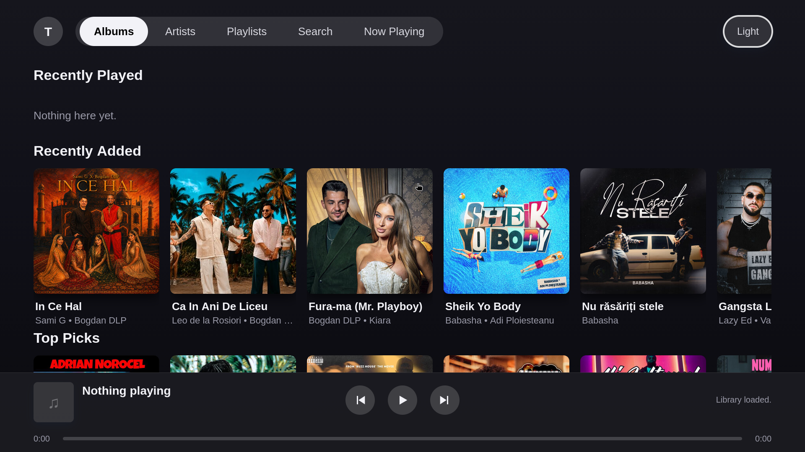
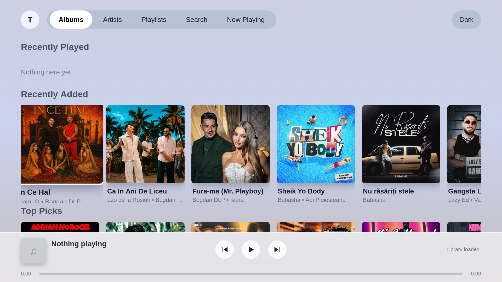
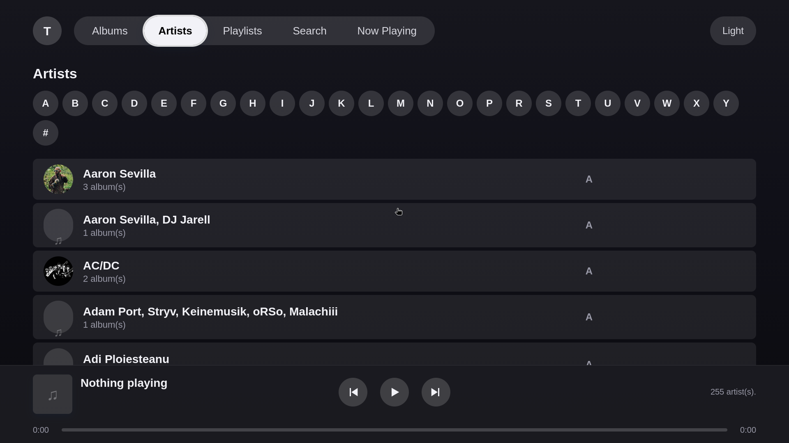
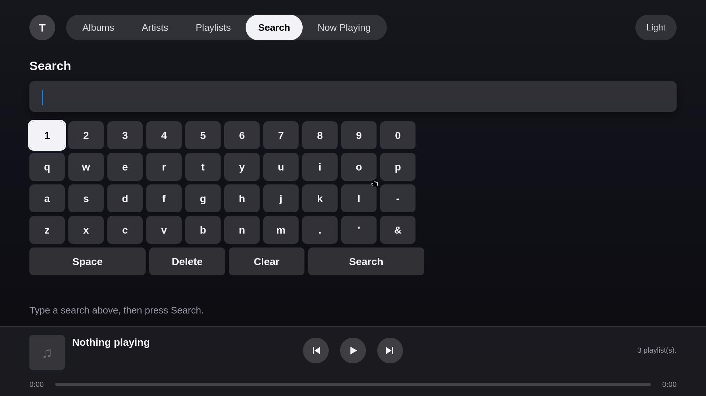

<div align="center">


# SubTizen

**A Subsonic-compatible music client for Tizen 2.4 smart TVs** — 2016 Samsung models.

[](https://www.tizen.org/)
[](https://developer.samsung.com/tv)
[](#build)
[](LICENSE)

</div>

---

A 10-foot music client driven entirely by the remote control. Talks to any
Subsonic-compatible server — Navidrome, Airsonic, Gonic, Subsonic — and renders an
Apple Music–style interface with synced lyrics.

## Screenshots

| Home (dark) | Home (light) |
|---|---|
|  |  |

| Artists | Search |
|---|---|
|  |  |

## Features

- 🎵 **Plays your library** — streams from any Subsonic server, transcoding FLAC/Ogg to MP3
- 🖼️ **Apple Music–style UI** — lavender gradient, translucent nav pill, artwork card rows
- 🎛️ **Full remote support** — D-pad, media keys, number-pad track jumps
- 📋 **Server playlists** — your Navidrome/Airsonic playlists, fetched live and playable
- 🎤 **Synced lyrics** — per-line highlighting from LRCLIB, backdrop tinted from album art
- 🌗 **Dark mode** — remembered across launches
- ✨ **Smooth motion** — covers fade in, rows rise in, the focused card grows, a card's art flies into the album page and back, and Now Playing's lyrics glide while the cover breathes with play and pause. On a slow TV the app notices and switches the optional motion off by itself ("lite mode")
- 🔍 **Search** — on-screen keyboard, since a TV remote has no text input
- 🔀 **Shuffle and repeat** — on the Now Playing screen; remembered across launches
- ❤️ **Favorites** — a heart on Now Playing stars the track on your server, and a Favorites row on Home lists them
- 📃 **Up Next** — see what plays next (in shuffled order too) and jump to any track
- 🎚️ **Mini-player** — a slim bar on every screen that also shows an AirPlay cast, with a green dot on the AirPlay tab
- ✅ **Scrobbling** — plays count on your server (Top Picks, play counts), and a track that fails to play is skipped
- 📡 **AirPlay receiver** — cast from an iPhone or Mac to the TV through a small [bridge](bridge/README.md) that runs on another machine on your network (artwork, title, progress; about 3–4 s delay)

## Screens

| Screen | What it does |
|---|---|
| **Home** | Recently Played, Favorites, Recently Added and Top Picks as horizontal card rows that page as you scroll right; empty rows are hidden |
| **Artists** | Every artist A–Z, with a letter strip; Enter opens their albums |
| **Playlists** | Playlists from the server, with owner and song count; Enter opens the track list |
| **Search** | On-screen keyboard with debounced results, albums first then songs |
| **Now Playing** | Large art, synced lyrics, seeker, transport buttons, shuffle/repeat, Favorite and Up Next |
| **AirPlay** | Shows what is being cast to the bridge, with artwork, title and progress; switches here automatically when a cast starts. The username icon in the nav bar reopens the connection settings, including the bridge address |
| **Player bar** | Slim and persistent on every screen except Now Playing; appears once something plays or is cast |

## Project layout

```
app/                 the web app (this is what gets packaged)
  config.xml         Tizen widget manifest, required_version="2.4"
  index.html         nav pill + all screens + transport bar
  css/style.css      Apple Music-inspired 10-foot UI, D-pad focus styling
  js/subsonic.js     Subsonic REST client (XHR, no fetch)
  js/lyrics.js       LRCLIB synced-lyrics client (XHR, no fetch)
  js/keys.js         Tizen remote key registration + keycode constants
  js/airplay.js      AirPlay bridge client (status polling + stream playback)
  js/app.js          UI logic, playback, remote keybindings
  lib/md5.js         pure-JS MD5 (RFC 1321 verified)
  res/icon.png       app icon
bridge/              AirPlay bridge service (runs on another machine, not the TV)
tools/package.sh     builds dist/SubTizen.wgt
```

## Package identity

Tizen requires the package id to be **exactly 10 alphanumeric characters**, so
`config.xml` uses `SubTizen01` as `tizen:application/@package` and
`SubTizen01.SubTizen` as the application id. The widget `version` is bumped for each
release; the current release is `1.1`.

## Build

```bash
./tools/package.sh
```

Produces `dist/SubTizen.wgt`. Uses the Tizen Studio packager if installed at
`~/tizen-studio` (set `TIZEN_PROFILE` to your signing profile), otherwise falls back to
plain `zip` — which is what a `.wgt` is. Note that a TV can reject an **unsigned** package
(`install failed[118]`); if yours does, sign it with a certificate that includes the TV's DUID
(for example with Tizen Studio's Certificate Manager, or `tizen-cli build`).

## Install on the TV
### Manual
Grab `SubTizen.wgt` from the [latest release](../../releases/latest), or build it
yourself with `./tools/package.sh`.

1. On the TV: **Apps → Settings → Developer mode**, enable it, and set the host PC's IP.
2. Reboot the TV, then:

   ```bash
   sdb connect <TV_IP>:26101
   sdb install dist/SubTizen.wgt
   ```

3. Launch **SubTizen** from the Apps screen.

### Apps2Samsung
Get the Apps2Samsung app and search for Subtizen
https://github.com/Apps2Samsung/Apps2Samsung

## AirPlay (optional)

A 2016 TV's web runtime cannot advertise Bonjour services, accept connections or decode AirPlay
audio, so receiving is done by a small Node service in [`bridge/`](bridge/README.md) that you run
on another always-on machine on the same network (a Raspberry Pi, a NAS, your Navidrome host).
It receives the AirPlay audio with [shairport-sync](https://github.com/mikebrady/shairport-sync)
and re-serves it, plus the track info and artwork, to the app over HTTP. The bridge has nothing to
do with your Subsonic server.

1. Install `shairport-sync`, `ffmpeg` and Node.js 16+ on that machine, then run
   `node bridge/subtizen-bridge.js --name SubTizen`.
2. In SubTizen, set the **AirPlay bridge** address on the connect screen (for example
   `http://192.168.0.10:5100`), or later via the username icon in the nav bar. Left blank, it uses
   your Subsonic server's host on port 5100.
3. Pick **SubTizen** in the AirPlay menu on your iPhone or Mac and play something. The app switches
   to the AirPlay tab by itself.

If the bridge machine runs a firewall, allow your local network to reach it. See the
[bridge README](bridge/README.md#firewall) for the details.

What to expect: audio plays through Samsung's AVPlay player and runs about **3–4 seconds behind**
the phone (that is the TV player's own buffering; the bridge sends audio almost immediately).
Pause, skip and volume are controlled from the phone. The TV remote's play/pause only mutes or
unmutes the stream on the TV, because iPhones give an AirPlay 2 receiver no way to send commands back.

## Remote control

| Key | Action |
|---|---|
| Up / Down / Left / Right | Move focus |
| Enter | Activate focused card, track, or button |
| Back / Return | Go back one screen |
| MediaPlay / MediaPause / MediaPlayPause | Playback control |
| MediaStop | Stop and rewind to 0 |
| MediaRewind / MediaFastForward | Seek back / forward 10s |
| MediaTrackNext / MediaTrackPrevious | Next / previous track |
| Number pad | Jump to track N in the open album |

Media and number keys only reach the page if the app registers them first via
`tizen.tvinputdevice.registerKey()`, which also requires the
`http://tizen.org/privilege/tv.inputdevice` privilege in `config.xml`. Without it the
registration fails silently and the remote's play/pause button does nothing.

Keycodes vary between TV models, so `keys.js` asks the device what it supports and
dispatches on the key *name*, falling back to hardcoded constants only when the device
reports nothing. If a button still does nothing, **press `0` three times** to show an
on-screen overlay of the last keycodes received.

## Tizen 2.4 constraints

| Constraint | Consequence |
|---|---|
| No `fetch` | All API calls use `XMLHttpRequest` |
| No `window.crypto.subtle` | `lib/md5.js` provides MD5 for token auth |
| WebKit decodes MP3/AAC, **not FLAC or Ogg/Opus** | Stream requests pass `format=mp3` |
| `maxBitRate` alone transcodes to **Ogg/Opus** | Always send `format=mp3` too |
| No ES6 modules / no build step | Plain scripts, ES5 syntax, IIFEs |
| WebKit does **not** move focus on arrow keys | D-pad navigation implemented in JS |
| Media/number keys are **not delivered unless registered** | `keys.js` registers them at startup |
| The `<audio>` element buffers ~20 s of a live stream and hides it from the page | AirPlay audio plays through Samsung AVPlay (`webapis.avplay`), with Web Audio tried first where it exists |

## Security notes

- **Token authentication** (`t=md5(password+salt)`, `s=salt`) is used by default, so the
  password itself never appears in a URL (server logs, proxies, on-screen errors). A server
  that refuses tokens with a Subsonic error (API older than 1.13, or LDAP users) is retried
  once with the legacy plaintext `p=` login, and that choice is remembered. The password is
  still stored in `localStorage` (the token is derived from it) and the stream and cover URLs
  carry a reusable token, so this is still meant for a trusted home LAN, **not the internet**.
- **Lyrics leave the LAN.** Track title, artist, and album are sent to LRCLIB. No
  credentials or server address are included. Point `BASE` in `app/js/lyrics.js` at a
  self-hosted instance to avoid this.

## Known gaps

- The queue is the open album, playlist or search result: Up Next shows it and lets you jump, but you can't add to or reorder it
- No volume control
- AirPlay: about 3–4 s behind the phone, and no transport control of the phone from the TV remote
- Servers that don't send `Access-Control-Allow-Origin` fail with `Network unreachable`
  (Navidrome sends permissive headers, so direct XHR works)

---

Detailed engineering notes — UI internals, D-pad and scrolling behaviour, keycode
diagnostics, and Tizen quirks — live in [HANDOVER.md](HANDOVER.md).

## License

[MIT](LICENSE) © 2026 therosaer.
